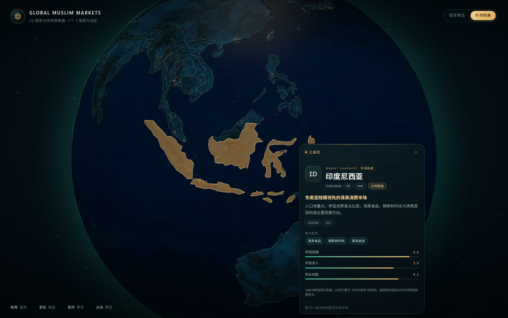

# Global Muslim Markets · 3D 国家与市场探索器

基于 **globe.gl** 的 3D 地球框架：悬停国家显示悬浮卡片，点击固定卡片并飞向该国。**卡片外壳（位置、悬停、固定、关闭、焦点）与卡片内容渲染完全解耦**，内容层可以在不改动外壳的情况下替换成市场档案、投资笔记、评审清单或任意业务视图。

开箱即可部署到 GitHub Pages。



---

## 包含什么

- **3D 地球**：globe.gl + three.js，夜间地球纹理、国家面、大气层、透明星空背景、自动旋转与拖拽/缩放。
- **国家悬停**：国家高亮 + 跟随指针的预览卡片，靠近视口边缘自动翻转/收敛。
- **国家点击**：卡片固定，国家选中高亮，镜头按国家范围飞到合适高度；支持 Esc、关闭按钮、点击地球空白处关闭。
- **卡片内容解耦**：`CardController` 只负责“卡片行为”，`CardContentRenderer` 只负责“卡片里放什么”；内置「国家概览」「市场档案」两个内容渲染器，可一键切换验证。
- **数据驱动**：国家基础资料由 ISO 数字代码、ISO alpha-2/3 或英文名匹配；市场档案缺失时优雅降级，不会出现空卡片。
- **桌面 / 移动端**：桌面为跟随指针的浮层；窄屏自动变为底部卡片，预览态不拦截点击，保证一次点按即可固定。
- **工程化**：Vite + TypeScript strict、19 个单元测试、GitHub Actions 自动部署、`VITE_BASE` 适配项目页子路径。

---

## 快速开始

需要 Node.js **22.12+**。

```bash
npm install
npm run dev        # http://127.0.0.1:5173
npm test           # 19 个测试
npm run build      # 类型检查 + 产物输出到 dist/
npm run preview
```

---

## 架构：一条单向的数据流

```
浏览器指针
   │
   ▼
GlobeScene ──► { country, point } ──► app.ts ──► CountryRepository
（只懂几何与交互）                    （组合根）        │
   │                                                   ▼
   │                                          CountryDetail（视图模型）
   │                                                   │
   ▼                                                   ▼
高亮 / 选中 / 镜头                          CardController（卡片外壳）
                                                       │
                                                       ▼
                                             CardContentRenderer（内容渲染器）
                                                       │
                                                       ▼
                                              country / mode / actions
```

### 三条边界

1. **`src/globe/` 不知道卡片和数据。**
   `GlobeScene` 只接收 `CountryShape[]`，发出带视口坐标的高亮/点击事件，并负责选中态、镜头移动和拖拽判定。

2. **`src/card/CardController.ts` 不知道卡片里有什么。**
   它创建外壳、计算位置、处理预览/固定状态、Esc/关闭、焦点、指针驻留与可访问性；内容由构造时注入的渲染器返回一个 DOM 节点。

3. **`src/data/` 不碰 DOM。**
   `CountryRepository` 把地理数据与两份 JSON 合并成 `CountryDetail`，纯函数式的 resolver 可以直接在 Node 里测试。

`src/app.ts` 是唯一的组合根：它把 globe 事件翻译成 repository 查询，再把结果和动作交给卡片外壳。**场景与卡片互不 import。**

### 目录

```
src/
├─ app.ts                  # 组合根：事件接线、数据、渲染器切换、启动
├─ main.ts                 # 入口与启动失败兜底
├─ config.ts               # 站点配置（纹理、初始视角、默认渲染器、数据地址）
├─ globe/
│  ├─ GlobeScene.ts        # globe.gl 场景、交互、选中/高亮、镜头
│  ├─ geo.ts               # TopoJSON → CountryShape，id/名称规范化（纯函数）
│  └─ types.ts             # CountryShape、GlobeHoverEvent 等
├─ card/
│  ├─ CardController.ts    # 卡片外壳：显示/隐藏、固定、位置、焦点、Esc
│  ├─ position.ts          # 浮层定位与边界翻转（纯函数）
│  ├─ registry.ts          # 内容渲染器注册表
│  ├─ types.ts             # 渲染器契约
│  ├─ dom.ts               # 安全 DOM 构造小工具
│  └─ renderers/
│     ├─ overview.ts       # 内容渲染器 #1：国家概览
│     ├─ market.ts         # 内容渲染器 #2：市场档案
│     └─ parts.ts          # 两个渲染器共用的可视零件
├─ data/
│  ├─ CountryRepository.ts # 加载 + 索引 + 合并 + 降级
│  ├─ types.ts             # CountryDetail / MarketProfile 契约
│  └─ labels.ts            # 区域中文化、面积格式化
├─ shared/coords.ts
├─ styles/                 # tokens / base / globe / chrome / card / loader
└─ ui/                     # 图标、加载器、Toast、星空
```

---

## 卡片契约

内容渲染器只需要实现下面这个接口：

```ts
export interface CardContentRenderer {
  readonly id: string;
  readonly label?: string;
  create(ctx: CardRenderContext): CardContentHandle;
}

export interface CardRenderContext {
  readonly country: CountryDetail; // 已合并的视图模型
  readonly mode: 'preview' | 'pinned';
  readonly actions: CardActions;   // close() / pin()
}

export interface CardContentHandle {
  readonly element: HTMLElement;
  update?(ctx: CardRenderContext): void; // 可选：原地更新
  destroy?(): void;                      // 可选：清理监听/定时器
}
```

外壳只做三件事：把 `handle.element` 插进 body、在模式或渲染器变化时调用 `update` / 重新 `create`、关闭时调用 `destroy`。它不读 `CountryDetail` 的任何字段。

### 新增一个卡片内容

1. 在 `src/card/renderers/` 新建文件，导出一个工厂：

```ts
export function createMyRenderer(): CardContentRenderer {
  return {
    id: 'my-card',
    label: '我的卡片',
    create(ctx) {
      const root = document.createElement('div');
      // 只依赖 ctx.country / ctx.mode / ctx.actions
      return { element: root };
    },
  };
}
```

2. 在 `src/card/registry.ts` 注册：

```ts
export const CARD_RENDERERS = {
  overview: { label: '国家概览', create: createOverviewRenderer },
  market: { label: '市场档案', create: createMarketRenderer },
  mine: { label: '我的卡片', create: createMyRenderer },
} as const;
```

3. 完成。顶部切换器自动多一个按钮，URL 支持 `?card=mine`；`CardController` 不需要任何改动。

### 外壳负责的行为

| 行为 | 说明 |
| --- | --- |
| 预览 / 固定 | 悬停预览；点击国家升级为固定卡片。固定卡片不会被悬停清掉。 |
| 指针跟随 | 预览态跟随指针；固定态停在点击位置，窗口 resize 时重新收敛到视口内。 |
| 边缘翻转 | 优先出现在指针右下；放不下时翻到左侧/上方，最后才 clamp。 |
| 指针驻留 | 鼠标移入卡片时暂停隐藏（可点击内容），离开后 240ms 再关闭。 |
| 关闭路径 | × 按钮、Esc、点击地球空白处、点击另一个国家切换。 |
| 移动端 | ≤700px 变为底部卡片；预览态 `pointer-events: none`，点按会穿透到地球完成固定。 |
| 可访问性 | 固定时卡片获得焦点；`role="dialog"` + 动态 `aria-label`；Esc 关闭；可见焦点环。 |
| 遮罩隔离 | 指针在顶部栏/卡片/Toast 上时，globe 的 window 级 raycast 会被过滤，避免在 UI 底下误触发国家卡片。 |

---

## 数据层

### 国家基础资料

`public/data/country-facts.json` 由脚本生成，不要手改：

```bash
npm run gen:facts
```

- 地理边界：`world-atlas/countries-110m.json`（TopoJSON，构建时打包）。
- 国家资料：`world-countries`，脚本裁剪成约 69KB（中英文名、ISO2/3、首都、区域、面积、旗帜、联合国成员标记）。
- 键：ISO 数字代码；无数字代码的地区退回 alpha-3 或英文名。
- 许可：world-countries 为 **ODbL-1.0**，衍生数据在 `meta` 中保留来源和许可字段。

### 市场档案

`public/data/market-profiles.json` 是**示例数据**，用来展示内容层的结构与降级路径：

```json
{
  "meta": {
    "demo": true,
    "updated": "2026-11",
    "notice": "当前为框架演示数据……"
  },
  "countries": {
    "360": {
      "headline": "东南亚规模领先的清真消费市场",
      "summary": "……",
      "sectors": ["清真食品", "穆斯林时尚", "清真旅游"],
      "tags": ["ASEAN", "OIC"],
      "scores": {
        "marketSize": 4.6,
        "accessibility": 3.9,
        "growthMomentum": 4.1
      }
    }
  }
}
```

- 键可以是 ISO 数字代码（`360`）、ISO alpha-3（`IDN`）或 alpha-2（`ID`）。
- `meta.demo: true` 时，市场卡片显示「示例数据」徽标与底部署名；**这些分数是占位值**，不构成任何市场结论。替换成真实数据前请移除 `demo` 或保持显著标注。
- 国家没有档案时显示空状态并提示补充位置，不会渲染半截卡片。
- 基础资料与市场档案分别加载；任一文件失败只影响对应内容，地球照常可用。

### 换成远程 API

`CountryRepository.load()` 现在是并行 fetch 两个静态 JSON。改成 API 时保留 `resolve(shape): CountryDetail` 的同步出口即可：在 `load()` 里预取，或把 `resolve` 改为异步并在 `app.ts` 中 await 后更新打开的卡片（`CardController.setRenderer` / renderer 的 `update` 已提供原地更新路径）。

---

## 配置

`src/config.ts`：

```ts
export const siteConfig = {
  cardRenderer: 'overview',        // 默认内容渲染器
  allowRendererSwitch: true,       // 是否显示顶部切换器
  globe: {
    textureUrl: publicAsset('textures/earth-night.jpg'),
    bumpTextureUrl: publicAsset('textures/earth-topology.png'),
    initialView: { lat: 22, lng: 68, altitude: 2.05 },
    autoRotate: true,
    autoRotateSpeed: 0.32,
    atmosphereColor: '#5fd6c2',
  },
  data: {
    factsUrl: publicAsset('data/country-facts.json'),
    marketUrl: publicAsset('data/market-profiles.json'),
  },
};
```

- 所有 public 资源都经过 `publicAsset()`，自动带上 Vite 的 `BASE_URL`，GitHub Pages 子路径不会 404。
- URL 参数：`?card=market` 直接打开市场档案内容渲染器。
- 减少动态效果：遵循 `prefers-reduced-motion`，关闭 globe 入场动画、镜头飞行动画和卡片进入动画。
- 修改地球纹理只需替换 `public/textures/` 下的文件并更新路径。

---

## 部署到 GitHub Pages

仓库已包含 `.github/workflows/deploy.yml`。

1. 推送到 GitHub 的 `main` 或 `master`。
2. 仓库 **Settings → Pages → Build and deployment → Source** 选择 **GitHub Actions**。
3. 等待 `Deploy to GitHub Pages` 工作流完成，访问输出的 URL。

工作流会：

- `npm ci` → `npm test` → `npm run build`；
- 自动计算子路径：项目页用 `/<repo>/`，`<user>.github.io` 用 `/`；
- 支持用仓库变量 `VITE_BASE` 覆盖（例如绑定自定义域名后设为 `/`）；
- 上传 `dist/` 并部署，`public/.nojekyll` 一并发布。

本地验证子路径构建：

```bash
export VITE_BASE=/global-muslim-markets/
npm run build
npm run preview
# 打开 http://127.0.0.1:4173/global-muslim-markets/
```

> 不要用 `file://` 直接打开 `dist/index.html`；ES module 与数据 fetch 需要静态服务器。

---

## 脚本

| 命令 | 作用 |
| --- | --- |
| `npm run dev` | Vite 开发服务器 |
| `npm run build` | `tsc --noEmit` + 生产构建 |
| `npm run preview` | 预览构建产物 |
| `npm run typecheck` | 仅类型检查 |
| `npm test` | Vitest 单元测试（geo / repository / position / registry） |
| `npm run gen:facts` | 从 `world-countries` 重新生成国家资料 |

测试覆盖的重点：

- TopoJSON 解析、176 个国家、ISO id、无 id 地区的稳定回退、质心；
- 国家资料/市场档案的 ISO 数字、alpha-2/3、英文名匹配与缺失降级；
- 卡片位置在四个方向的翻转和视口 clamp；
- 渲染器注册表的未知 id 回退与 URL 值防护。

---

## 已知边界 / 下一步

- **键盘探索**：3D 球面目前是 pointer-only。卡片本身支持 Esc 与焦点管理，但还不能用键盘在国家间移动。下一步可加“国家搜索 + 列表”作为等价入口。
- **数据是演示级**：市场档案是结构示例，发布前必须替换并核实；评分不是研究结论。
- **包体**：three.js/globe.gl 让主 chunk 约 620KB gzip；地球纹理已压到约 240KB，且异步加载、不阻塞地球首帧。若首屏预算仍然敏感，可在空闲时动态 `import()` globe 场景。
- **固定卡片与镜头**：固定卡片锚定在点击时的屏幕位置；旋转地球不会让卡片跟随国土质心（这是浮层方案的有意取舍）。
- **110m 几何**：小岛与极小的国家边界较粗，部分属地没有独立几何；`country-facts.json` 有 249 条资料，地图只有 176 个 feature，属于预期差异。
- **i18n**：界面文案目前是中文硬编码；`CountryDetail` 已把中英文名字分开，抽语言包不涉及卡片契约。

---

## 素材与许可

- [globe.gl](https://github.com/vasturiano/globe.gl)（MIT）、[three.js](https://threejs.org/)（MIT）。
- 国界数据：[world-atlas](https://github.com/topojson/world-atlas)（ISC；数据源 Natural Earth，公有领域）。
- 国家资料：[world-countries](https://github.com/mledoze/countries)（**ODbL-1.0**）；`country-facts.json` 是其衍生数据库，`meta` 中保留来源与许可。
- 地球夜景/地形纹理：来自 [three-globe](https://github.com/vasturiano/three-globe) 示例素材（NASA Earth 影像，公有领域）。
- `market-profiles.json` 与界面文案为本项目示例内容；发布真实市场数据前请替换并注明来源。
